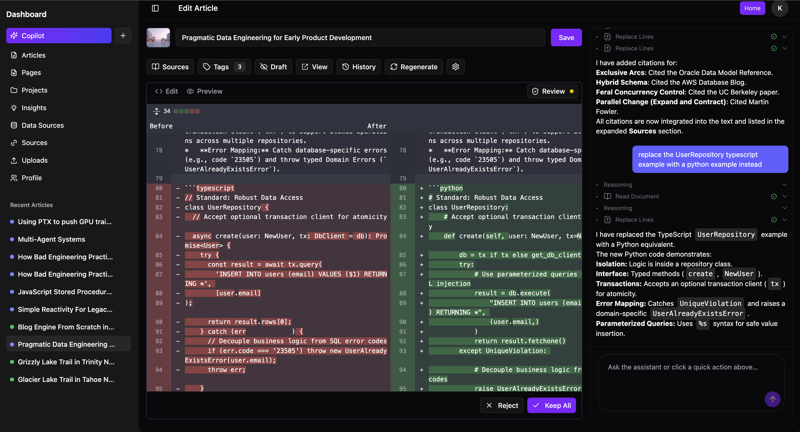

# Blog Copilot

An agentic blog editor with a React/Bun frontend and an Axum/Rust backend.



## Run the full stack

Docker Compose provides PostgreSQL 17.4 with pgvector, Diesel migrations,
deterministic OpenAI/Exa fixtures, MinIO, the Rust API, and the frontend:

```bash
docker compose up --build
```

- Frontend: <http://localhost:3000>
- API: <http://localhost:8080>
- Health: <http://localhost:8080/health>
- Swagger UI: <http://localhost:8080/swagger>
- OpenAPI: <http://localhost:8080/api/openapi.json>
- MinIO console: <http://localhost:9001>

The local database and object store use named volumes. Tests never connect to
the production Supabase database.

## Development

Docker Compose is the hermetic default and needs no environment file. For a
native backend, copy the tracked local profile and start only its dependencies:

```bash
cp env/local.env.example env/local.env
docker compose up -d db external-fixtures object-storage object-storage-init
./scripts/with-env.sh env/local.env \
  cargo run --manifest-path backend/Cargo.toml --locked --bin blog-backend
```

The profiles under `env/` are explicit local command inputs:

- `local.env` connects native processes to local Docker dependencies.
- `testing.env` supplies only local fixture and test-database settings.
- `production.env` is for deliberate local access to Supabase and production
  services. It must never contain `TEST_DATABASE_URL`.

Copy the corresponding `*.env.example` file to create a profile. Real `*.env`
files are ignored by Git and excluded from Docker build contexts. The Fly app
`kevingil-blog` holds production environment variables and does not use these
files. See [`env/README.md`](env/README.md) for the command convention.

```bash
cd frontend
bun install --frozen-lockfile
bun run dev
```

For native frontend development, put browser-visible values in `frontend/.env`:

```env
VITE_API_BASE_URL=http://localhost:8080
VITE_WS_URL=ws://localhost:8080/websocket
VITE_PUBLIC_S3_URL_PREFIX=http://localhost:9000/blog
```

`VITE_GA_MEASUREMENT_ID` is optional. Leave it unset locally. Set it to a GA4
measurement ID (`G-…`) only in the production frontend build.

The backend's `PUBLIC_API_URL` and `PUBLIC_APP_URL` configure MCP OAuth callback
and return origins. Model endpoints in the local profile use fixtures; unset
model endpoints use the real OpenAI, Groq, and Exa APIs.

## Migrations and production deployment

The production database already has the seven Goose migrations through
`20260315000000`. Preserve those SQL bodies and version IDs. Stamp their Diesel
ledger entries once, then apply the four newer Diesel migrations for connectors,
skills, external article URLs, and upload records. Do not revert or replay the
historical schema against this database.

[`scripts/pre-deploy.sh`](scripts/pre-deploy.sh) runs as the Fly release command
on every API deploy. It exits before migration if the initial schema fingerprint
does not match or an existing Diesel ledger is missing baseline versions. Once
adopted, subsequent deploys apply only pending migrations. See the
[adoption runbook](docs/porting/MIGRATION_ADOPTION.md) for the exact commands,
retry behavior, and fingerprint limitations. Fresh local databases still use
`migrate` directly through Compose.

[`fly.toml`](fly.toml) defines the production API, `kevingil-blog`, in `sjc` on
one `shared-cpu-1x` Machine with 256 MB. The image is the repository
[`Dockerfile`](Dockerfile). The frontend stays on Cloudflare Workers at
`https://kevingil.com` and is not part of the Fly app. Production reuses the
existing Supabase database and R2 bucket; it creates neither. Deploy from the
repository root:

```bash
flyctl deploy --remote-only --ha=false
```

Production settings:

| Setting | Value |
| --- | --- |
| `DATABASE_URL` | Existing Supabase direct or session-pooled URL with TLS; not a transaction pooler (migrations hold a session advisory lock) |
| `AUTH_SECRET` | Existing signing secret |
| `PUBLIC_API_URL`, `VITE_API_BASE_URL` | Public HTTPS API origin, without a trailing slash |
| `PUBLIC_APP_URL`, `ALLOWED_ORIGINS` | Public HTTPS frontend origin (`ALLOWED_ORIGINS` also accepts comma-separated origins) |
| `VITE_WS_URL` | Public API origin using `wss://`, followed by `/websocket` |
| `S3_URL_PREFIX`, `VITE_PUBLIC_S3_URL_PREFIX` | Existing public bucket/CDN prefix |
| Other `S3_*`, provider API keys | Existing production credentials and bucket settings |

The image builds the API, migrator, stamper, and fingerprint diagnostic. Fly
runs `/usr/local/bin/pre-deploy` before the new version serves traffic, then
starts `/usr/local/bin/blog-backend`. Docker remains available for local Compose
and migration diagnostics. Builds require PostgreSQL's `libpq` development
library; runtime requires libpq and trusted CA certificates. HEIC uploads are
converted to JPEG before storage. iPhone photos from iOS 18 need libheif 1.18
or newer; the image installs that `heif-convert` from bookworm-backports.

The API's async PostgreSQL pool supports TLS with certificate and hostname
verification. Use `sslmode=require` in the production
`DATABASE_URL` to prevent unencrypted connections. Supabase's shared session
pooler on port `5432` provides IPv4 connectivity without its paid direct IPv4
add-on and supports the migration session lock. Copy the exact URL from
Supabase's Connect dialog. Do not use the transaction pooler on port `6543`.
Local PostgreSQL without TLS remains supported through its default `prefer`
mode. The synchronous migration binaries use libpq, so verify API database
connectivity as well as successful migrations during deployment.

### Supabase TLS certificate

Configure the Supabase root CA before deploying the API. The API loads system
roots by default, which may not trust Supabase's database certificate chain.
`scripts/fly-entrypoint.sh` writes the certificate before the server or the
release command starts.

1. In the Supabase **blog** project, open **Database → Settings → SSL
   configuration → Download certificate**. Use the certificate supplied by
   that project. See [Supabase's SSL documentation](https://supabase.com/docs/guides/platform/ssl-enforcement).
2. Base64-encode the PEM, including the `BEGIN CERTIFICATE` and `END
   CERTIFICATE` lines, and set it as the Fly secret `SUPABASE_CA_CERT_B64`.
   The entrypoint decodes it to `/tmp/supabase-ca.crt` and sets
   `SSL_CERT_FILE`. `SSL_CERT_DIR` stays `/etc/ssl/certs` so the system roots
   remain available. Setting either variable overrides the TLS library's
   default certificate discovery.

If pre-deploy succeeds but the API exits with `error performing TLS handshake`,
check this certificate configuration. The migration binaries use libpq, where
`sslmode=require` normally encrypts without verifying the server certificate;
the API's Rust TLS client verifies it. Successful migrations therefore do not
prove the API trusts the server. After fixing trust, redeploy normally: the
stamper skips recorded baseline versions and the migrator applies only pending
versions. Do not reset the ledger or rerun historical SQL to fix a TLS error.

### Frontend configuration and cutover

The public API origin is `https://kevingil-blog.fly.dev`. Set
`PUBLIC_API_URL` to that origin and bake the same origin into the frontend
`VITE_*` variables. Use public hostnames, not internal service hosts.
Frontend `VITE_*` values are public and baked into the build; rebuild it after
changing them and configure its host to rewrite SPA deep links to `index.html`.
Set `VITE_GA_MEASUREMENT_ID` in the Cloudflare build environment when the
deployed site should load Google Analytics. The tag is omitted unless that
value is a GA4 measurement ID, so local builds, Compose, and forks stay quiet.

The Cloudflare Workers frontend uses
[`frontend/wrangler.jsonc`](frontend/wrangler.jsonc) to serve Vite's `dist`
directory with `assets.not_found_handling: "single-page-application"`. This
serves `index.html` for direct navigation to React routes such as
`/projects?page=1`. In Cloudflare Builds, use `frontend` as the root directory,
`bun run build` as the build command, and `npx wrangler deploy` as the deploy
command. Redeploy the frontend after changing this configuration.

Fly runs the release command before shifting traffic, so a migration failure
blocks the new API deployment. Production never runs the local fixture seed.
Existing accounts remain intact.

## Verification

The blocking Rust matrix is partitioned into exact targets so failures identify
their owning domain:

```bash
cp env/testing.env.example env/testing.env
docker compose --profile test up -d \
  test-db test-migrate external-fixtures object-storage object-storage-init
./scripts/with-env.sh env/testing.env \
  cargo test --manifest-path backend/Cargo.toml --locked --test article_service
```

Select only the targeted test required for the change. The broader maintained
test scripts remain available for explicit release verification. The test
profile uses a separate `blog_test` PostgreSQL database on port `55433`; it does
not reuse the normal local `blog` database.

Run the same blocking matrix in the pinned Docker environment:

```bash
docker compose --profile test run --build --rm test
```

The insight behavior target is always compiled and executed, but CI reports its
11 exact cases separately because that subsystem remains work in progress.

The Go/Rust parity environment uses independent PostgreSQL 17.4 databases. It
fetches the pinned [kevingil/blog-go](https://github.com/kevingil/blog-go)
source as a Docker build context, so the reference implementation does not
remain in this repository:

```bash
docker compose -f docker-compose.parity.yml up --build \
  --abort-on-container-exit --exit-code-from contract-tests contract-tests
```

## MCP demo

[`scripts/mcp-demo.sh`](scripts/mcp-demo.sh) starts the same test-profile
Postgres and MinIO services, migrates a separate `blog_mcp_demo` database with
the local `migrate` binary, and runs `blog-backend` against the local fixture
process. The first account, `mcp-demo@example.com` / `McpDemoPass123!`, is the
admin. The script mints an `mcp_` token and writes a project-scoped
[OpenCode](https://opencode.ai) config in its own workspace. It does not edit
`~/.config/opencode`. That config registers `http://127.0.0.1:8080/mcp` as a
remote MCP server (`oauth: false`, `Authorization: Bearer {env:BLOG_MCP_TOKEN}`,
`codemode: false`, `protocol: "legacy"`). `codemode: false` puts the server's
`search` and `execute` tools on the model's tool list as `blog_search` and
`blog_execute`.

The script installs OpenCode CLI 2.4.2 (`@opencode/cli`) when that version is
not already on `PATH` or in its cache, starts a private `opencode serve` in
that workspace, and runs `opencode run --format json` against it on
[`scripts/mcp-demo-prompt.txt`](scripts/mcp-demo-prompt.txt). That prompt
states the outcomes and does not include paths or code: search the API, write
two drafts on a theme, list them, revise one, edit the page `mcp-demo-desk`,
upsert `https://example.test/mcp-demo-harbor` twice, attach two sources, list
storage, and try to read the current user. The script then reads those rows
back through the REST API and exits non-zero if any check fails.

`MCP_DEMO_MODEL` is required, in `provider/model` form, and is passed to
`opencode run --model`. There is no default. OpenCode reads the provider
credential from the environment. Any OpenCode provider works: OpenAI, another
lab, or an open-source model behind an OpenAI-compatible endpoint. The script
does not set a provider, a base URL, or an API key.

```bash
MCP_DEMO_MODEL=openai/gpt-6.1-sol ./scripts/mcp-demo.sh
MCP_DEMO_MODEL=anthropic/claude-sonnet-5-5 ./scripts/mcp-demo.sh
```

An unset `MCP_DEMO_MODEL` exits non-zero. `MCP_DEMO_CLIENT=1` skips OpenCode,
does not require a model, and runs the scripted MCP client in
[`scripts/mcp-demo.mjs`](scripts/mcp-demo.mjs). That path does not write an
OpenCode transcript. The script is not part of CI.

Logs and, when `asciinema` is installed, a cast of the run go to `tmp/mcp-demo`.
Set `MCP_DEMO_ARTIFACT_DIR` to write them somewhere else. `agg` renders a gif
from the cast, and `ffmpeg` makes an mp4 from that gif.

## OpenAPI and frontend client

Axum routes and the OpenAPI document share the same Utoipa construction path.
The frontend client is generated from that document:

```bash
./scripts/generate-client.sh
node ./scripts/verify-openapi-contracts.mjs
```

Generated files under `frontend/src/client/` must not be edited by hand.
Frontend service adapters use the generated SDK and add only application-level
authentication, envelope, and view-model behavior.

## Architecture

Dependencies point inward and production dependencies are assembled once in
`backend/src/bootstrap.rs`:

```text
api (Axum DTOs, handlers, OpenAPI)
  -> core (domain services and consumer-owned ports)
       <- database (Diesel/PostgreSQL)
       <- integrations (OpenAI, Exa, S3, fetch/extract)

bootstrap -> AppState -> typed FromRef substates
```

Application-owned cancellation tokens and task sets cover the HTTP server,
article/image queues, WebSocket bridges, workers, and
graceful SIGINT/SIGTERM shutdown.
